← [Back to README](../README.md)

# Console build: Lite (Waveshare ESP32-S3-Touch-LCD-1.47)

A small, low-interaction console for a **1.47″ 172×320** screen. It shows
the scale weight, identifies the spool you put on the NFC reader, and
assigns it to the AMS slot you load it into, all without a single tap.
It shows the same screens as the full console, condensed onto one screen;
Quick Weight, adding an unlinked tag to the inventory, unlinking a tag and
the settings are each a tap or two.
Firmware: [`espoolbuddy_console_lite.yaml`](../espoolbuddy_console_lite.yaml).

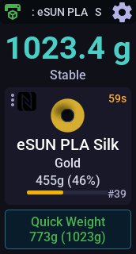 

*A scanned spool waiting to be loaded into the AMS.*

It talks to Bambuddy directly, like the other consoles, and has its own PN532
for scanning. It has no load cell: the weight comes from an
[ESPoolBuddy Scale](scale.md), which pushes its readings to every console in
its `console_url` list. Without a scale, the weight area just reads
*No scale*. Scanning and auto-assign work either way.

The Lite console runs its own compact UI
(`espoolbuddy/bundles/console_lite.yaml`), not the tabbed UI of the [WT32-SC01 Plus](console-wt32sc01.md) and
[Panda Touch](console-pandatouch.md) consoles. Use one of those if you want
to browse AMS slots, link tags to existing spools, or manage storage
locations on the device itself (see [Known limitations](#known-limitations)
and the [feature comparison](comparison.md#full-console-vs-lite)).

## Bill of materials

| Part | Notes |
|---|---|
| Waveshare ESP32-S3-Touch-LCD-1.47 | ESP32-S3, 16 MB flash, 8 MB PSRAM, 172×320 touch display (JD9853 panel, AXS5106L touch). Display, touch and backlight are onboard. |
| PN532 NFC module | **I²C mode**: DIP switch **1 = ON, 2 = OFF** |
| 5 jumper wires | PN532 to the board's header |
| USB-C cable | For the first (wired) flash and power |
| [ESPoolBuddy Scale](scale.md) | Optional: provides the weight reading |

## Wiring the NFC reader

The PN532 runs in I²C mode on its own bus, separate from the touch
controller. The NFC driver polls from its own task, so sharing the touch bus
would let the two collide.

| PN532 pin | Board | Notes |
|---|---|---|
| GND | GND | |
| VCC | 3V3 | |
| SDA | GPIO17 | I²C data (`nfc_i2c` bus) |
| SCL | GPIO18 | I²C clock |
| IRQ | GPIO16 | Open-drain; firmware enables an internal pull-up |

With the IRQ wire the firmware reacts to a tag right away, as on the
WT32-SC01 Plus console. Without it, remove `irq_pin:` from the YAML and the
firmware falls back to polling every `poll_interval` (300 ms by default),
as on the Panda Touch. That still works, just slightly slower to react.

> **Pins to double-check.** The display data/control pins, display reset
> (GPIO40) and touch reset (GPIO47) are confirmed. These are best guesses,
> marked `# unverified` in the YAML:
> - backlight GPIO46
> - touch SDA/SCL GPIO42/41 and touch INT GPIO48
> - PN532 bus GPIO17/18 and IRQ GPIO16
> - the octal PSRAM mode
>
> If the backlight stays dark, touch doesn't respond, or boot reports a
> PSRAM error, check those first against Waveshare's schematic. Any free
> header pins work for the PN532 bus and IRQ.

<details>
<summary>Pin map (reference only)</summary>

| Function | GPIO |
|---|---|
| LCD SCK / MOSI / CS / DC / RST | GPIO38 / GPIO39 / GPIO21 / GPIO45 / GPIO40 |
| Backlight (PWM) | GPIO46 *(unverified)* |
| Touch (AXS5106L) SDA / SCL | GPIO42 / GPIO41 *(unverified)* |
| Touch INT / RST | GPIO48 *(unverified)* / GPIO47 |
| PN532 SDA / SCL | GPIO17 / GPIO18 *(unverified, any free pair)* |
| PN532 IRQ | GPIO16 *(unverified, any free pin)* |

</details>

The display is driven by `mipi_spi` with the JD9853 vendor init from
Waveshare's demo (40 MHz, 34 px column offset) in its native portrait orientation. The touch controller uses the community
[`axs5106`](https://github.com/widget/esphome-components) component, which
the YAML pulls in automatically.

## Get the weight from the scale

Add the Lite console to the scale's `console_url` list (in
`espoolbuddy_scale.yaml`); see [Scale → Point it at the console](scale.md#point-it-at-the-console):

```yaml
console_url:
  - "http://espoolbuddy-console.local"   # first entry: authoritative console
  - "http://espoolbuddy-lite.local"      # the Lite console
```

If the Lite console is the only one, list just its URL. Tare and calibrate
commands only reach the scale from the **first** console in the list, so put
the Lite console first if you want its **Tare** and **Calibrate** buttons to
work.

## Using it

The Lite shows the same screens as the full console's NFC and Scale tabs,
with the same texts, colours and icons, stacked on one screen. The header
works like the full console's:
- the printer icon is green while the selected printer is connected, red
  otherwise;
- the middle shows the clock (the selected printer is on the settings
  panel's Printer tile);
- status messages (for example "Weight saved", "Created spool #43",
  "Timed out — rescan to assign") take that place for 6 s.

### Weighing

| | |
|---|---|
|  | **Stable.** The live scale weight; it reads *Stable* once the reading has settled. |
| 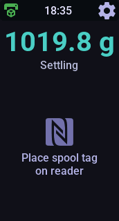 | **Settling.** The reading is still moving; it reads *Stable* once it is steady. |
| 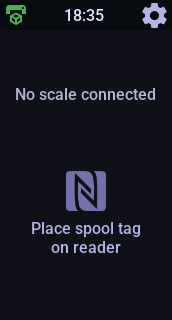 | **No scale connected.** No weight pushes are arriving. Scanning and auto-assign still work; Quick Weight is hidden. |

### Scanning and auto-assign

| | |
|---|---|
| 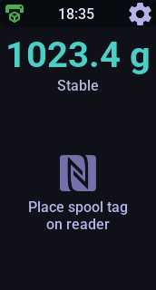 | **Waiting for a tag.** With nothing on the reader the screen shows *Place spool tag on reader* (the weight stays on top, so this is the same view as above). |
|  | **Spool scanned.** As on the full console: spool icon in the filament colour, brand / material, colour, remaining filament with the level bar, the spool ID and the tag type. Load it into any AMS slot while the countdown (top right) runs and it is assigned automatically. |
| 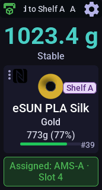 | **Assigned.** The *Assigned:* banner names the slot; after 4 s the screen returns to *Place spool tag on reader*. |
| 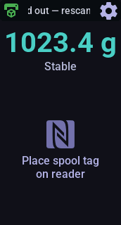 | **Timed out.** No AMS load within 60 s. Scan the tag again to retry. |
| 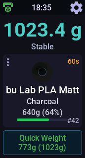 | **Taken out of the AMS.** A known spool removed from an AMS slot comes up like a fresh scan, ready for Quick Weight. Put it back, or into another slot, and that slot is assigned. |
| 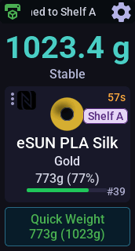 | **Storage location.** With a spool on screen, scan a storage-location tag: the spool is assigned to that location in Bambuddy, and the location shows as a badge. Location tags are linked on a full console or in Bambuddy. |

### Quick Weight

| | |
|---|---|
| 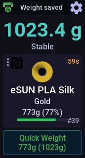 | **Stable reading.** The button shows the filament weight and the total, e.g. *773g (1023g)*. One tap records it in Bambuddy (*Weight saved*). |
| 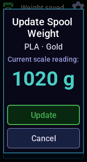 | **Not stable yet.** The *Update Spool Weight* popup shows the live reading; **Update** records it. |
| 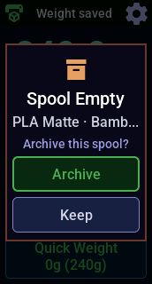 | **Empty spool.** If the weight says no filament is left, the Lite offers to archive the spool in Bambuddy. **Keep** leaves it as it is. |

### Unlinked tags

| | |
|---|---|
| 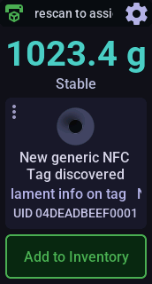 | **Unlinked tag.** The tag isn't linked to a spool yet. |
| 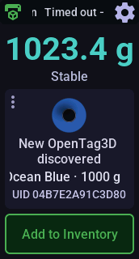 | **OpenTag3D tag.** Its decoded data (manufacturer, material, colour, weight) is previewed the same way. |
| 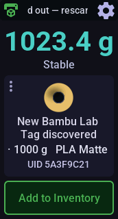 | **Tag with spool data.** Bambu Lab and OpenTag3D tags carry material and colour, shown as a preview. **Add to Inventory** creates a spool from that data (a generic 1000 g PLA for a plain tag) and links the tag to it. |
| 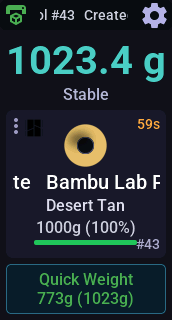 | **Created.** The new spool is shown like a scanned one, ready to be loaded into the AMS or weighed. |

### Spool actions

Tap the spool view (the ⋮ in its corner) for the same actions as the full
console's ⋮ menu, plus Discard.

| | |
|---|---|
| 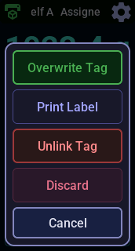 | **Write Tag** has Bambuddy write the spool's data to the NTAG on the reader; it reads **Overwrite Tag**, with a confirmation, when the tag already holds data. **Print Label** prints the spool's label ([label printer](label-printer.md) only). **Unlink Tag** removes the tag from the spool. **Discard** clears the spool from the screen. |
| 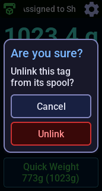 | **Unlink confirm.** Afterwards the screen shows *Place spool tag on reader* with *Tag unlinked*. Scan the tag again and it shows as unlinked, ready for **Add to Inventory**. |
| 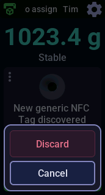 | **Unlinked tag actions.** **Discard** hides the tag until it is scanned again. |

### Build plate clear

| | |
|---|---|
| 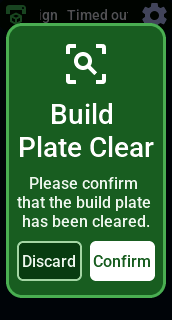 | When Bambuddy waits for the build plate to be cleared (its "Require plate-clear confirmation" setting), the popup appears and wakes the screen. **Discard** hides it until the printer asks again. |

### Settings

Tap the cog, or swipe down, as for the full console's quick settings. Swipe
up or tap ✕ to close. The panel scrolls.

| | |
|---|---|
| 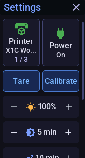 | **Printer** — tap to switch to the next printer; auto-assign uses the selected one. **Power** — tap to switch the printer's power plug (the plug Bambuddy marks as controlling the printer; the tile is hidden without one). **Tare** and **Calibrate** the scale. **Brightness** (−/+). |
| 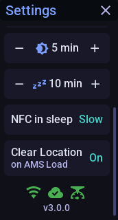 | **Inactivity** (−/+) — sleep after 5–60 min without touch, scan or weight change, or *Never*. **NFC in sleep** — tap to switch between *Slow* (default) and *On*, which keep scanning so a tag wakes the screen, and *Off*, which stops the reader while asleep. **Clear Location on AMS Load** — tap for On/Off. WiFi, Bambuddy and scale status, and the firmware version. |
| 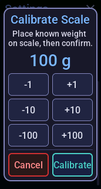 | **Calibrate Scale.** Put a known weight on the empty scale, set it with the buttons, tap **Calibrate**. |

All settings are kept across restarts.

**Dim and sleep.** As on the full console, the backlight dims after 60 s
without activity and turns off after the *Inactivity* time. Putting a spool
on the scale, scanning a tag (unless NFC in sleep is *Off*), a build-plate
popup or a touch wakes it. The waking touch doesn't also press a button.

## Known limitations

The Lite covers the day-to-day loop. Where it differs from the full console,
it's because the 1.47″ screen is too small:

- **Spool actions are behind a tap** on the spool view instead of a row of
  buttons.
- **The header shows only the clock**, not the full console's
  "printer - clock"; the selected printer is on the settings panel.
- **Settings are one scrolling panel** of compact rows (−/+ steppers and
  tap-to-switch values) instead of the full console's settings pages with
  their slider and segment buttons.
- **Text is heavier and brighter.** The Lite uses Roboto Medium (14 px for
  the smallest text instead of 12 px) and lighter greys for secondary text,
  because the full console's thin Roboto Regular is hard to read on the
  small panel.
- **Linking a tag to an existing spool** (the full console's *Assign Spool*
  picker) isn't available. The Lite can add a new spool from an unlinked
  tag.
- **No AMS overview, slot details or manual slot assignment.**
- **No linking of tags to storage locations, and no smart-plug list.**
  Scanning an already linked location tag, and the printer's power plug,
  do work.
- **No speaker**, so no chimes, and no *WiFi in sleep* setting.
- **Tare and calibrate need the first `console_url` entry.** A scale only
  takes these commands from the first console in its list
  ([above](#get-the-weight-from-the-scale)).

## Setup & flashing

Wire the PN532 as above, then follow the
[setup & flashing guide](setup.md), using `espoolbuddy_console_lite.yaml`
wherever it says `<console file>`.

To try the UI without hardware, run the
[desktop simulator](development.md):
`esphome run host/espoolbuddy_console_lite_host.yaml`.
