← [Back to README](../README.md)

# Using the device

Screenshots are from the 480×320 WT32-SC01 Plus console with demo data. The
Panda Touch shows the same screens at 800×480. The
[Lite console](console-lite.md#using-it) has its own single-screen UI; its
page shows the same situations, with the same demo data, on the Lite.
Scanning, auto-assign, Quick Weight, the archive and build-plate prompts,
storage-location tags and sleep all work the same way there. Its page walks
through every screen.

- **Scan a tag**: hold an NFC tag (Bambu Lab spool tag, or your own NTAG
  213/215/216) near the console's or scale's PN532 antenna. The console
  jumps to the NFC tab automatically on a new scan; with no tag on the reader
  that tab shows *Place spool tag on reader*.

  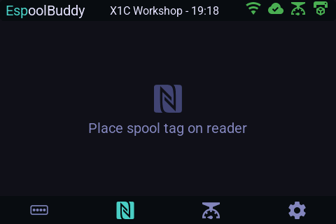
  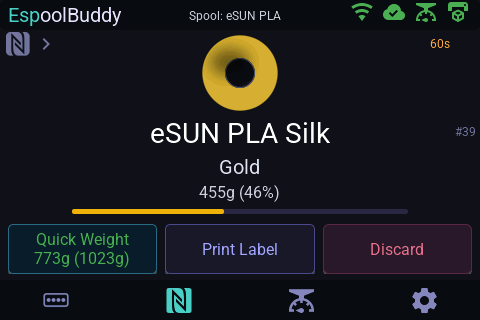

- **Scan + load auto-assigns the AMS slot**: after scanning a tag linked to
  a known spool, loading that physical spool into any AMS slot within the
  next 60 s automatically assigns the spool to that slot in Bambuddy and
  configures it — no manual assignment step needed. The countdown runs in the
  top-right corner, and a green **Assigned:** banner names the slot once it's
  done. If nothing is loaded in time, the header shows *Timed out — rescan to
  assign*.

  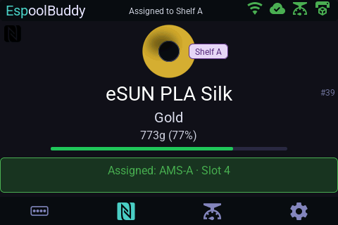
  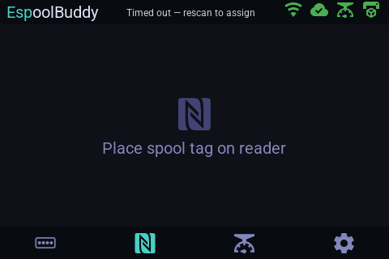

- **Removing a spool from the AMS behaves like scanning it**: when a known,
  already-loaded spool is taken out of an AMS slot, ESPoolBuddy treats that
  exactly like the tag being scanned again (same chime, same jump to the NFC
  tab). You can immediately load it into the same or a different slot and
  that slot gets assigned/configured automatically, same as a fresh scan.

  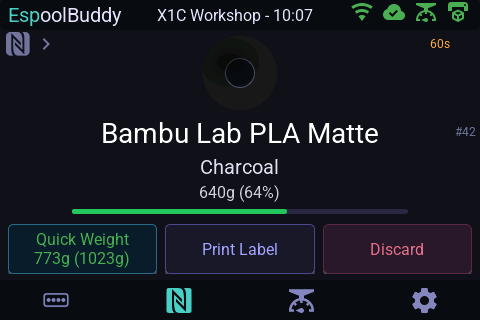

- **Storage locations**: from Settings → **Storage Locations**
  you can link an NFC tag to any storage location already created in
  Bambuddy — tap **Scan to Link** on a location, a popup confirms it's
  waiting (tap **Dismiss** in it to back out), then present the tag. Tap
  **Unlink** to clear a location's tag. A tag already linked to another
  location — or already linked to a spool — is refused, with that same
  popup instead naming what it's linked to, rather than silently ending up
  claimed by two things at once; unlink it there first if you want to move
  it. Once linked, scanning that tag while a spool is staged (freshly
  scanned, or just removed from an AMS slot) assigns the spool to that
  location in Bambuddy; scanning it with nothing staged just shows a brief
  confirmation. A spool's current storage location, if any, shows as a
  purple badge next to its icon on the NFC detail view. By default, loading
  a spool into an AMS slot also clears its storage location automatically
  (Bambuddy itself does not do this) — turn this off in Settings → Features
  → **Clear Location on AMS Load** if you'd rather it was left as-is.
  With Spoolman, the location list comes from Bambuddy's own catalog, which
  it fills from the locations found on your Spoolman spools when it refreshes
  its spool list (at most about once a minute), so a location you only just
  typed into Spoolman can take a moment to show up here. A spool that was
  loaded into an AMS under Bambuddy before 1.2.5.4 may still carry an old
  location like `H2D-1 - AMS A1` in Spoolman, and the badge shows it as-is.
  Linking a tag to a location is an ESPoolBuddy feature: the tag is kept in
  the location's `identifier` field in Bambuddy, which Bambuddy itself does
  not use yet.

  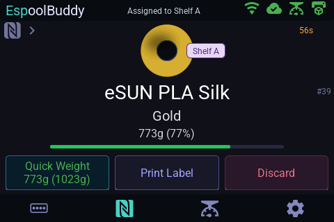
  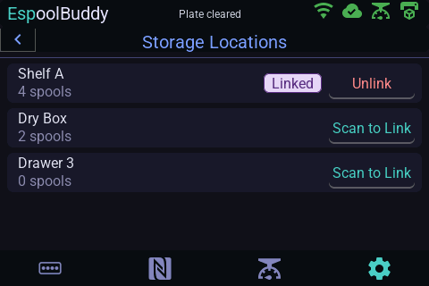

- **Unknown tag → create a spool entry**: scanning a tag with no matching
  spool in Bambuddy opens the unlinked-tag panel with an **Add to
  Inventory** button. For a Bambu Lab tag the new spool is populated from
  the tag itself — material and subtype, colour name and RGBA, brand,
  label weight, slicer filament id and hotend temperatures. An
  [OpenTag3D](https://opentag3d.info) tag is decoded the same way —
  material and modifier, manufacturer, colour name and RGBA, label and
  empty-spool weight and hotend temperatures. For any other tag (plain NTAG,
  foreign spool, or a tag that could not be decoded) it falls back to a
  default entry (PLA, 1000 g). Either way the spool is linked to
  that tag and carries a `"Created by ESPoolBuddy"` note so it's easy to
  identify later. With the Spoolman backend everything above is still filled
  in except the hotend temperatures, which Bambuddy does not accept for
  Spoolman spools. This works the same whether the tag was scanned on the
  console or on the scale — the scale decodes the tag itself and pushes the
  decoded values to the console along with the UID. Once it's created, the
  new spool is shown just like a scanned one: its details, the 60 s window to
  load it into an AMS slot, and **Quick Weight**.

  The panel already previews what will be added: the title names the tag
  type ("New Bambu Lab Tag discovered", "New OpenTag3D discovered" or "New
  generic NFC Tag discovered"), the spool icon is tinted in the tag's colour, and
  the line below the title shows the material, colour name and spool weight
  decoded from the tag (plus the manufacturer for OpenTag3D). Tags without
  decodable filament data show a grey spool and "No filament info on tag".

  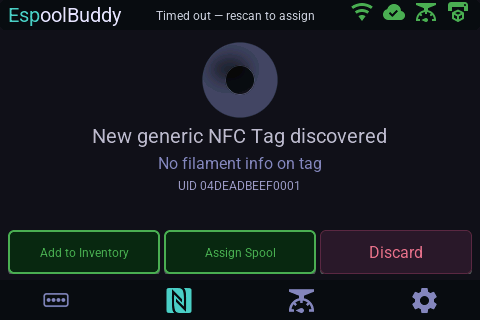
  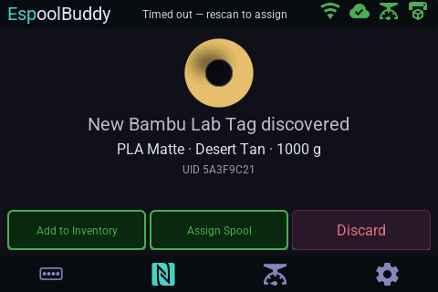
  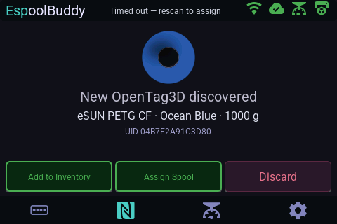

  After **Add to Inventory** the new spool is shown like a scanned one, with
  *Created spool #N* in the header:

  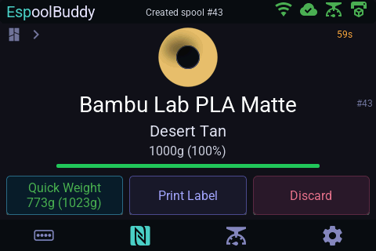

- **Unknown tag → link to an existing spool**: from that same panel, use
  **Assign Spool** instead to link the tag to an existing, untagged spool.
  The picker shows your 9 most recently added spools in a grid for quick
  selection, but you're not limited to those: **Enter spool ID** opens a
  keypad for any spool ID. Below the number it names the spool that ID
  belongs to, so a typo shows before you tap **Link**.

  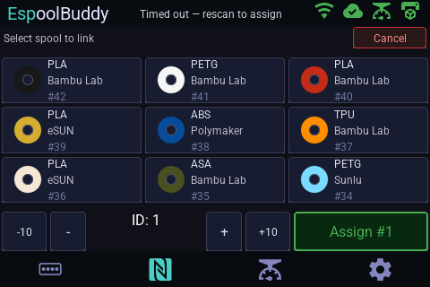

- **Weigh a spool**: place it on the scale — the weight and a "stable"
  indicator show on the console once the reading settles (~750 ms after it
  stops changing). While it is still moving it reads *Settling*; with no
  scale reporting it reads *No scale connected*.

  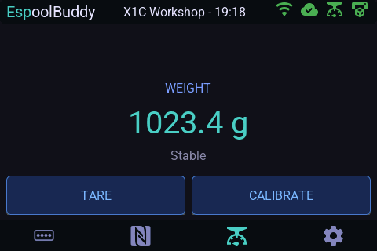
  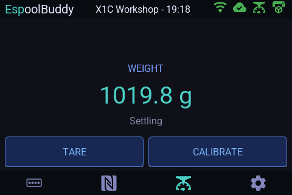
  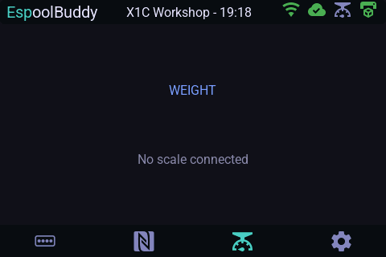

  **Calibrate** asks for a known weight on the empty scale: type its weight
  in grams on the keypad (it starts at the last one used) and tap
  **Calibrate**.

  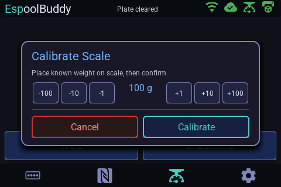

- **Quick Weight**: with a spool shown and the scale stable, the **Quick
  Weight** button shows the filament and total weight (e.g. *773g (1023g)*);
  one tap records it in Bambuddy (*Weight saved*). If the reading isn't stable
  yet, the **Update Spool Weight** popup shows it live and **Update** records
  it. When the weight says the spool is empty, the console offers to archive
  it (**Archive** / **Keep**).

  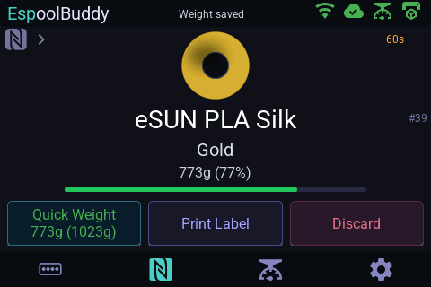
  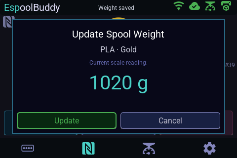
  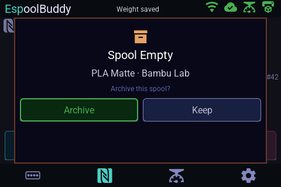

- **Tag chip and tag menu**: the top-left corner of the spool view shows
  the tag's format. For a tag carrying [OpenTag3D](https://opentag3d.info)
  data it also says how that data compares with the spool in Bambuddy
  (material, brand and colour): *Matches spool* in green or *Differs* in red.
  Two more say the data is right but a rewrite would improve the tag:
  - *Older format* (blue): OpenTag3D v1 on an NTAG215 or NTAG216, once
    Bambuddy has sent the newer v2 with a write.
  - *Needs rewrite* (amber): written by Bambuddy before it fixed its layout.
    The console reads such tags, but phones and other readers see them as
    empty.

  A **›** next to it means it opens the tag menu:
  - **Write spool to tag**, for an NTAG linked to the spool, writes the spool
    to an NTAG213, NTAG215 or NTAG216 as an OpenTag3D record, which other
    readers (phones, printers) can read without Bambuddy. It reads *Overwrite
    tag with spool* for a tag holding other NDEF data (a URL, another app's
    record), and asks before writing over it; this works for a tag on the
    scale too, with scale firmware from this version on. *Rewrite tag with
    spool* when the data differs or needs a rewrite, and *Update tag to newer
    format* for an older format. With a Bambuddy that sends it, an NTAG215 or
    NTAG216 gets OpenTag3D v2, and an NTAG213 keeps v1, as v2 doesn't fit. The
    tag need not be on the reader yet: a popup asks for it, follows the write
    and tells you when it's done or why it failed. **Cancel** stops a write
    still waiting for a tag; after 60 s without one it gives up by itself.
  - **Unlink** removes the tag from the spool after a confirmation; the tag
    then shows as unlinked when scanned again. For an NTAG on the console's
    reader that holds data (an OpenTag3D record, say), the confirmation also
    offers **Unlink + Erase**: once the unlink has gone through, the tag's
    NDEF message is emptied, so it can be reused for another spool. Keep the
    tag on the reader until the popup says *Tag erased*.

  The console never asks to write a tag by itself, so nothing changes for
  tags that are never written. The write popup also shows for writes started
  from Bambuddy's SpoolBuddy **Write** page (`/spoolbuddy/write-tag`).
  Whatever is on the tag is overwritten; Bambu Lab tags are never written.

  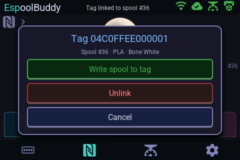
  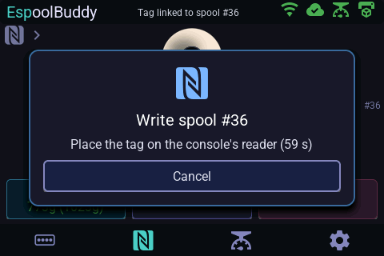
  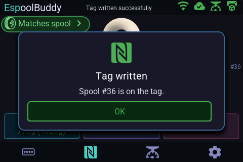
  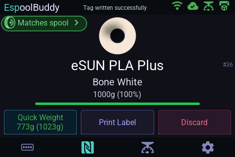
  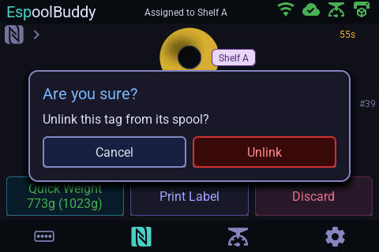

- **Discard** clears the spool from the screen.
- **AMS / printer status**: the console's AMS tab shows live slot/filament
  state polled from Bambuddy, along with each AMS unit's temperature,
  humidity, and its custom name if one was set in Bambuddy (falls back to a
  default label otherwise). The unit's icon, name, temperature and humidity turn
  orange while it is running a drying cycle. The currently selected
  printer's name also
  shows in the header next to the clock; it only scrolls if the text is too
  long to fit, otherwise it just sits centered. Tap a slot to see its
  spool's details (brand, material, colour, temperatures, remaining weight)
  and to clear its assignment; tapping an empty slot opens the same spool-ID
  keypad to assign a spool to it.

  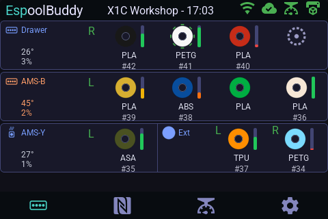
  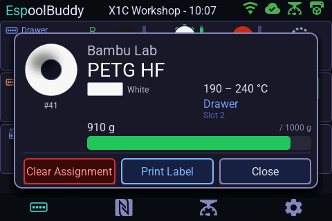
  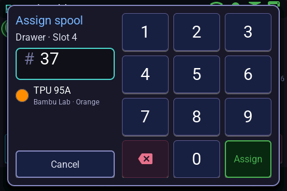

- **Swipe between AMS pages**: on the AMS tab, swipe left for the next page and
  right for the previous one — the same thing the prev/next buttons do, and
  equally limited to the pages that actually exist.
- **AMS rows per screen**: Settings → Features → **Rows/Page** controls how
  many AMS rows are shown at once (1/2/3 on the WT32-SC01 Plus console,
  1/2/3/5 on Panda Touch). Fewer rows per page means each row — and its
  icons and text — grows to fill the freed space instead of leaving it
  blank; more AMS units than fit on one page are reached via the existing
  prev/next buttons. Defaults to the max for your console, which looks the
  same as before this setting existed.

  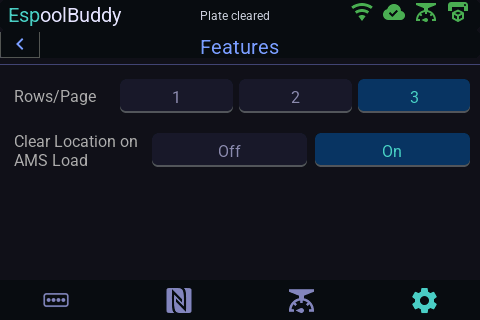

- **Plate-clear popup**: when Bambuddy's queue is waiting for you to confirm
  the build plate is empty after a print, the console shows a full-screen
  **Build Plate Clear** popup (and wakes the screen) with **Confirm** and
  **Discard** buttons — Confirm does the same as Bambuddy's "Clear Plate"
  button. It follows Bambuddy's **Require plate-clear confirmation** setting
  (Settings → Workflow → Queue & Dispatch, off by default): on in Bambuddy 
  shows the popup after every print, off never shows it. The setting is 
  unrelated to Bambuddy's camera-based plate detection. The console re-reads
  it every poll interval, so a change in Bambuddy takes effect within one 
  poll interval (30 s by default).

  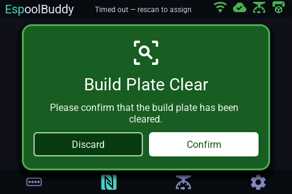

- **Header clock format**: follows Bambuddy's **Time format** setting.
  **12h** shows `2:05 PM`; **24h** and **System** both show `14:05`, since
  the console has no system locale to follow. Like the plate-clear setting,
  it's re-read every poll interval.
- **Quick settings**: swipe down from anywhere on the console to pull open a
  quick-settings drawer, and swipe up, tap its chevron handle, or tap the
  dimmed area behind it to close it again. It holds up to three tiles:
  **Power** — only shown when there is a smart plug to act on: one assigned
  to the selected printer, or one not assigned to any printer. If the
  selected printer has a plug with "Controls printer power" enabled in
  Bambuddy, tap to toggle it on/off (icon lights up green while on) and hold
  to open a popup listing every relevant plug (the printer's own, plus any
  not assigned to a printer) so you can flip each individually. If there is
  no such power plug, tapping opens that popup directly. The popup stays
  open after a toggle so you can switch several in a row, and only closes
  via its **Close** button — **Printer** — tap to
  switch to the next printer, hold to open the full printer picker; the icon
  is green while that printer is reachable — and **Sound**, which
  mutes/unmutes the chimes and stays in sync with Settings → Features →
  Sound. That Settings row also sets the chime volume to Low, Med or High,
  playing a chime at the level you pick. The drawer stays out of the way while a dialog is open or the
  screen is asleep.

  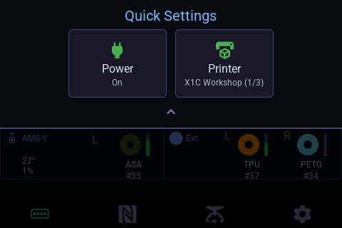

- **Sleep**: the console dims its backlight after 60 s idle and can go into
  a deep-idle "sleep" tier (backlight off, reduced network cadence) after a
  configurable timeout — any touch, new tag, or weight change wakes it.
- **Scale status LED**: red = no WiFi, blue = WiFi up but console
  unreachable, green = fully connected. With several consoles: green = all
  reachable, blue = only some, red = none.

See the [configuration reference](configuration.md) for the settings behind
several of these (poll intervals, sleep timeout, and more).
